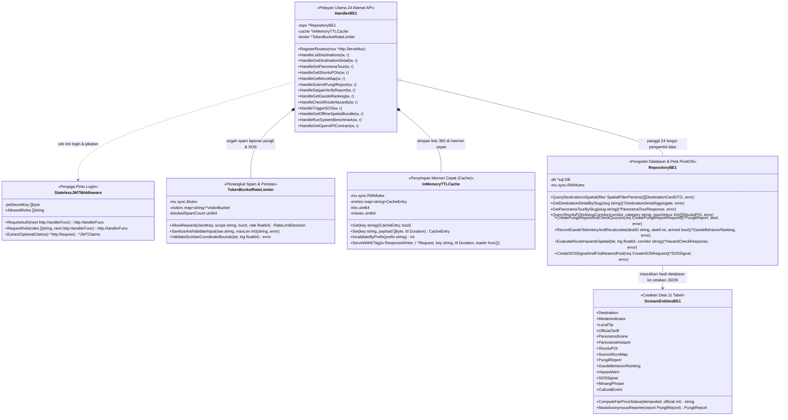

# Dokumentasi Lengkap Diagram ERD, Class Diagram, Alur & Fitur BE-1
**Proyek**: Rancak.in (WISGO) — Aplikasi Wisata Sumatera Barat  
**Bagian Anda**: Backend 1 (`BE-1`: Mengurus Peta, Tempat Wisata, Foto 360°, Anti-Pungli, Jalur Ekstrem & Budaya Minang)  
**Cakupan**: Minggu 1 sampai Minggu 4 (11 Tabel Database & 24 Alamat API di `backend/internal/be1_core/`)

---

## 1. Diagram Tabel Database (ERD — 11 Tabel BE-1 + Hubungan ke BE-2)

Seluruh nama tabel dan kolom (field) di bawah ini telah disesuaikan ke dalam **Bahasa Indonesia** agar mudah dimengerti.

```mermaid
erDiagram
    DESTINASI_WISATA {
        varchar id_destinasi PK "Kode unik wisata (dest-001..020)"
        varchar kode_url_slug UK "Alamat link web"
        varchar nama_wisata "Nama tempat wisata"
        varchar kabupaten_kota "Lokasi Kab/Kota di Sumbar"
        varchar kategori_wisata "alam | budaya | kuliner | nagari | bahari"
        geometry_point titik_koordinat_gps "Titik koordinat peta GPS"
        int ketinggian_mdpl "Ketinggian tempat (mdpl)"
        boolean apakah_hidden_gem "Penanda wisata tersembunyi"
        varchar kode_plang_qr UK "Kode plang QR di lokasi"
        varchar tingkat_keramaian "sepi | sedang | ramai"
        int estimasi_biaya_rupiah "Perkiraan biaya per orang"
        timestamptz waktu_diperbarui "Waktu terakhir data diubah"
    }

    INDIKATOR_MEDAN {
        varchar id_indikator_medan PK
        varchar id_destinasi FK "1:1 ke destinasi_wisata"
        varchar kondisi_jalan_akses "Kondisi aspal/jalan"
        boolean bisa_masuk_mobil "Bisa masuk mobil atau tidak"
        boolean bisa_masuk_motor "Bisa masuk motor atau tidak"
        numeric kemiringan_tanjakan_derajat "Kecuraman tanjakan"
        varchar tingkat_kesulitan_jalan_kaki "mudah | sedang | menantang"
        varchar kualitas_sinyal_hp "4G_stabil | 4G_lemah | susah_sinyal"
        varchar operator_sinyal_terbaik "Sinyal kartu paling bagus"
        boolean ada_toilet_bersih "Ada toilet bersih"
        boolean ada_musala "Ada musala"
        varchar nama_pengelola_pokdarwis "Nama pengelola lokal"
    }

    TIPS_LOKAL_ADAT {
        varchar id_tips PK
        varchar id_destinasi FK
        varchar judul_tips "Judul tips"
        text isi_penjelasan_tips "Isi aturan sopan santun adat / keselamatan"
        varchar jenis_tips "etika_adat | keselamatan | waktu_terbaik"
        boolean wajib_dibaca "Wajib baca sebelum berangkat"
    }

    TARIF_RESMI_PERDA {
        varchar id_tarif PK
        varchar id_destinasi FK
        varchar nama_komponen_biaya "Tiket / Parkir / Pemandu"
        varchar kategori_biaya "tiket_masuk | parkir_resmi | pemandu"
        int harga_resmi_rupiah "Harga resmi pemerintah (Rp)"
        varchar satuan_tarif "per orang | per mobil | per jam"
        varchar nomor_aturan_perda "Nomor aturan Perda / Nagari"
        boolean apakah_biaya_wajib "Wajib atau opsional"
    }

    ADEGAN_PANORAMA_360 {
        varchar id_adegan_360 PK
        varchar id_destinasi FK
        varchar judul_sudut_pandang "Nama sudut pandang 360"
        text url_gambar_360 "Link gambar 360 derajat"
        text url_suara_latar "Link suara suasana alam"
        numeric sudut_vertikal_awal "Arah kamera atas-bawah"
        numeric sudut_horizontal_awal "Arah kamera kiri-kanan"
        numeric jarak_zoom_awal "Zoom awal kamera"
        boolean apakah_foto_utama "Foto 360 utama"
    }

    TITIK_PIN_360 {
        varchar id_pin_360 PK
        varchar id_adegan_360 FK
        varchar jenis_pin "info | navigasi | budaya | peringatan"
        numeric posisi_atas_bawah
        numeric posisi_kiri_kanan
        varchar label_singkat_pin "Tulisan di atas pin"
        text isi_penjelasan_pin "Cerita saat pin diklik"
        varchar id_adegan_tujuan_pindah FK "Tujuan pindah foto 360"
    }

    TEMPAT_MAMPIR_SEARAH {
        varchar id_tempat_mampir PK
        varchar id_destinasi FK
        varchar nama_koridor_jalan "Nama jalur jalan raya"
        varchar nama_tempat_mampir "Nama tempat mampir"
        varchar kategori_tempat_mampir "masjid_musala | kuliner_pakem | spbu_rest"
        geometry_point titik_koordinat_gps "Titik GPS tempat mampir"
        int tambahan_waktu_belok_menit "Tambahan waktu belok (+X menit)"
        int jarak_belok_meter "Jarak belok dari jalan utama"
    }

    PETA_MIKRO_KAWASAN {
        varchar id_peta_mikro PK
        varchar id_destinasi FK
        varchar judul_peta_kawasan "Nama peta dalam lokasi"
        jsonb poligon_batas_kawasan "Garis batas kawasan wisata"
        jsonb garis_rute_jalan_kaki "Garis jalur jalan kaki"
        jsonb daftar_titik_fasilitas_internal "Titik loket, toilet, & spot foto"
        jsonb daftar_titik_pemicu_audio "Titik pemutar cerita suara otomatis"
    }

    LAPORAN_PUNGLI {
        varchar id_laporan_pungli PK
        varchar id_destinasi FK
        varchar id_pengguna_pelapor FK "ID pelapor (Disamarkan jika Anonim)"
        boolean apakah_anonim "Mode rahasia identitas"
        varchar kategori_pelanggaran "Jenis pungli / getok harga"
        int nominal_diminta_oknum_rupiah "Harga yang diminta oknum"
        int nominal_resmi_seharusnya_rupiah "Harga resmi seharusnya"
        geometry_point titik_gps_kejadian "Titik GPS kejadian pungli"
        text url_foto_bukti "Foto bukti"
        varchar status_tindak_lanjut "baru_masuk | peringatan_aktif | selesai_ditindak_satgas"
        text catatan_penindakan_satgas "Catatan penertiban Satgas"
    }

    PERINGKAT_KUNJUNGAN_GPS {
        varchar id_peringkat PK
        varchar id_destinasi FK
        varchar kategori_peringkat "Kategori peringkat"
        int jumlah_kedatangan_navigasi_30h "Jumlah orang sampai (45%)"
        int rata_rata_lama_betah_menit "Rata-rata lama betah (35%)"
        int jumlah_pengunjung_unik_30h "Jumlah pengunjung unik (20%)"
        numeric skor_total_perilaku "Nilai akhir otomatis (0-100)"
    }

    PERINGATAN_BAHAYA_DAN_SOS {
        varchar id_bahaya_atau_sos PK
        varchar kode_koridor_ekstrem "sitinjau_lauik | lembah_anai | kelok_9 | kelok_44"
        varchar jenis_bahaya_atau_darurat "longsor | kabut_tebal | banjir_lahar"
        varchar tingkat_kewaspadaan "waspada | siaga | awas_tutup"
        geometry_point titik_gps_pusat_kejadian "Titik pusat bahaya / SOS"
        int radius_dampak_meter "Jarak radius bahaya (meter)"
        text saran_jalur_alternatif "Saran jalan memutar yang aman"
        boolean apakah_masih_aktif "Masih berlangsung atau sudah aman"
    }

    KAMUS_MINANG_DAN_AGENDA_BUDAYA {
        varchar id_kamus_atau_agenda PK
        varchar id_destinasi FK "Lokasi acara budaya"
        varchar kategori_topik "Topik kalimat / acara"
        text kalimat_indonesia_atau_acara "Kalimat Bahasa Indonesia"
        text terjemahan_bahasa_minang "Kalimat Bahasa Minang"
        varchar panduan_baca_suku_kata "Cara baca per suku kata"
        text url_rekaman_suara "Suara contoh pengucapan"
        varchar jadwal_hari_pakan_nagari "Jadwal hari pasar nagari"
    }

    PENGGUNA_BE2 {
        varchar id_pengguna PK "Tabel akun milik BE-2"
        varchar peran_jabatan "wisatawan | admin_dispar | satgas_pungli | petugas_bpbd"
    }
    RUANG_GRUP_DAN_VOTING_BE2 {
        varchar id_ruang_grup PK "Fitur voting grup milik BE-2"
        varchar id_destinasi FK "Meminjam ID wisata dari BE-1"
    }
    PESANAN_PEMANDU_ESCROW_BE2 {
        varchar id_pesanan_escrow PK "Fitur pesan pemandu milik BE-2"
        varchar id_destinasi FK "Meminjam ID wisata dari BE-1"
    }
    PASPOR_DIGITAL_NAGARI_BE2 {
        varchar id_stempel_paspor PK "Fitur paspor stempel milik BE-2"
        varchar id_destinasi FK "Cek lokasi & kode QR ke BE-1"
    }

    DESTINASI_WISATA ||--|| INDIKATOR_MEDAN : "1:1 info kondisi jalan & sinyal"
    DESTINASI_WISATA ||--o{ TIPS_LOKAL_ADAT : "1:N punya banyak tips adat"
    DESTINASI_WISATA ||--o{ TARIF_RESMI_PERDA : "1:N punya daftar harga resmi"
    DESTINASI_WISATA ||--o{ ADEGAN_PANORAMA_360 : "1:N punya foto keliling 360"
    ADEGAN_PANORAMA_360 ||--o{ TITIK_PIN_360 : "1:N punya 4 jenis titik pin"
    DESTINASI_WISATA ||--o{ TEMPAT_MAMPIR_SEARAH : "1:N punya tempat mampir searah"
    DESTINASI_WISATA ||--|| PETA_MIKRO_KAWASAN : "1:1 punya peta jalan kaki"
    DESTINASI_WISATA ||--o{ LAPORAN_PUNGLI : "1:N menerima laporan pungli"
    DESTINASI_WISATA ||--|| PERINGKAT_KUNJUNGAN_GPS : "1:1 punya nilai peringkat GPS"
    DESTINASI_WISATA ||--o{ KAMUS_MINANG_DAN_AGENDA_BUDAYA : "0..1:N lokasi acara adat"

    PENGGUNA_BE2 ||--o{ LAPORAN_PUNGLI : "Baca ID dari tiket login JWT"
    DESTINASI_WISATA ||--o{ RUANG_GRUP_DAN_VOTING_BE2 : "Dipakai fitur grup BE-2"
    DESTINASI_WISATA ||--o{ PESANAN_PEMANDU_ESCROW_BE2 : "Dipakai fitur booking BE-2"
    DESTINASI_WISATA ||--o{ PASPOR_DIGITAL_NAGARI_BE2 : "Dipakai fitur paspor BE-2"
```

---

## 2. Diagram Bagian Kode Go (`Class Diagram be1_core`)

